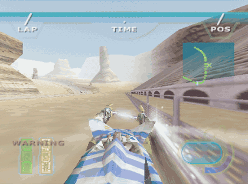
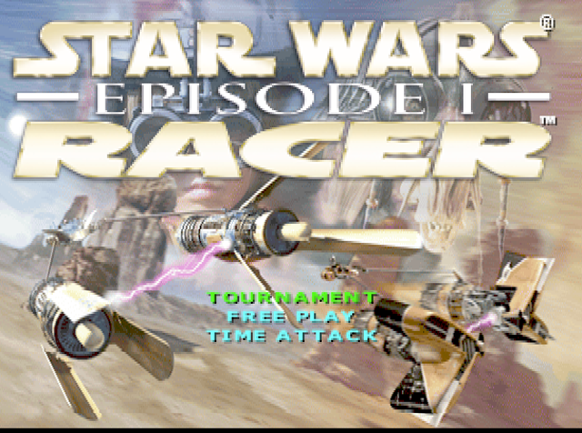
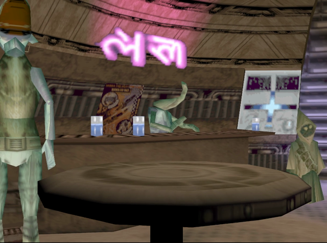
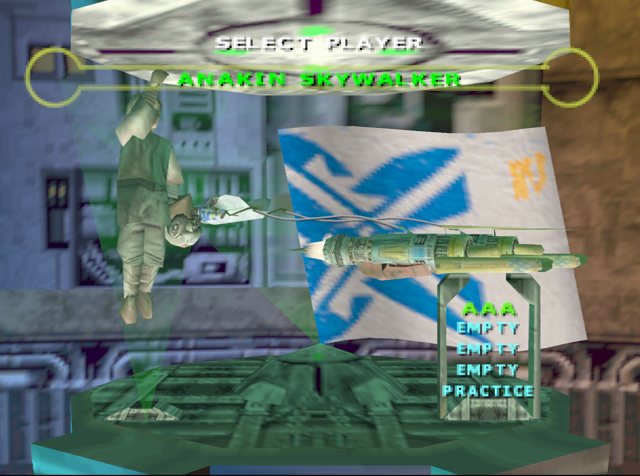
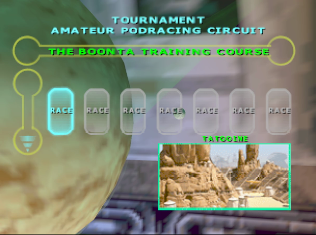
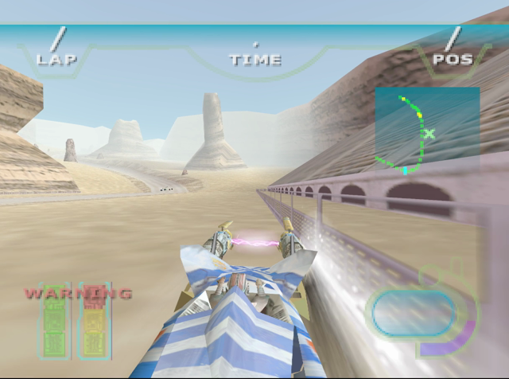
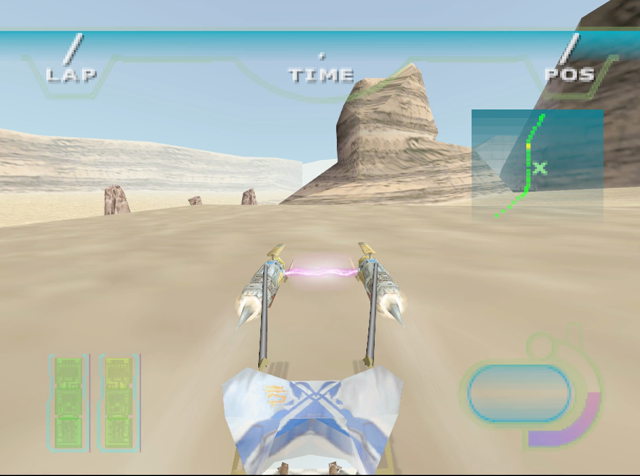

# Star Wars Episode I: Racer - N64 Static Recompilation

```
    ____________________________
   /  ________________________  \
  /  /  ___________________  \  \
 /  /  / ___ _    _ ____ _ \ \  \
|  |  | / __| |  | |  __/ | |  |  |
|  |  | \__ \ |/\| | |__  | |  |  |     "Now THIS is podracing!"
|  |  | |___/\    /|____|_| |  |  |          - Anakin Skywalker
|  |  |  ___ _  _ ___ __   |  |  |
|  |  | | __| \/ | _ /  \  |  |  |
|  |  | | _||  . |  /  __|_|  |  |
|  |  | |___|_/\_|_| \___| |  |  |
 \  \  \___________________/  /  /
  \  \________________________/  /
   \____________________________/
```

<p align="center">
  
</p>

## What is this?

This is a **static recompilation** project for *Star Wars Episode I: Racer* on the Nintendo 64, using [N64Recomp](https://github.com/N64Recomp/N64Recomp). The goal: take the original N64 binary and recompile it into native PC code, so you can podrace at modern resolutions and framerates without emulation.

No existing N64 decompilation exists for this game. We're flying blind through Beggar's Canyon here, folks.

## Status

| Milestone | Status |
|-----------|--------|
| ROM Analysis | COMPLETE |
| Function Discovery (878+ functions) | COMPLETE |
| Symbol File Generation | COMPLETE |
| N64Recomp Config | COMPLETE |
| Debug Tooling (analyzer, differ, strings, progress) | COMPLETE |
| Build System (Make + CMake) | COMPLETE |
| libultra Stubbing (~120 functions) | COMPLETE |
| N64Recomp Integration | COMPLETE |
| **Native Compilation (MSVC)** | **COMPLETE** |
| **N64ModernRuntime Integration** | **COMPLETE** |
| **libultra Function Identification (25 reimplemented)** | **COMPLETE** |
| **Game Boot + Stable Execution** | **COMPLETE** |
| **RSP Task Routing (osSpTaskLoad/StartGo)** | **COMPLETE** |
| **osRecvMesg Thread Blocking Fix** | **COMPLETE** |
| **Event System Wiring (VI, SI, Timer)** | **COMPLETE** |
| **Thread Scheduling Fixes** | **COMPLETE** |
| **Game Thread Boot + Controller Init** | **COMPLETE** |
| **Split-Function Fallthrough Auto-Fix (143 funcs)** | **COMPLETE** |
| **Full Boot → Stable Main Loop (no crashes)** | **COMPLETE** |
| **PI DMA / Asset Loading** | **COMPLETE** |
| **RSP Task Submission (audio + graphics)** | **COMPLETE** |
| **Display Lists Reach RT64 (processed)** | **COMPLETE** |
| **RT64 Renderer Integration** | **COMPLETE** |
| **Visible Frame Output (intro, title, menus, races)** | **COMPLETE** |
| **Controller input + EEPROM saves** | **COMPLETE** |
| **Controllers (SDL), 4 ports, rebinding, config file** | **COMPLETE** |
| **High-res output (RT64 resolution scale, MSAA)** | **COMPLETE** |
| Widescreen | EXPERIMENTAL |
| Texture packs (RT64 format) | SUPPORTED |
| **In-game: tournament race on Boonta Training Course** | **COMPLETE** |
| **Correct 4:3 presentation in every VI mode** | **COMPLETE** |
| Audio Reimplementation | TODO |
| Playable Build | IN PROGRESS |

**Current Progress: Phase 8 - In Game**

*"Now THIS is podracing!"*

The port now runs on current upstream N64Recomp, N64ModernRuntime and RT64 and plays from the intro through the title menu, tournament setup and into a race you can drive (no sound yet). The fixes were mostly libultra functions that had been stubbed or misidentified: `osSetThreadPri`, `osPiReadIo`, `osViSetMode`/`osViSwapBuffer`/`osViBlack`, `osViGetCurrentFramebuffer`, the EEPROM and controller functions, and `_Putfld` (sprintf). The runtime fixes needed for it are open as PRs on the sp00nznet forks of N64ModernRuntime (#1–#8) and RT64 (#1).

Controls, settings and texture packs: see [Playing](#playing).

## Screenshots

Captured from the recompiled build (RT64, D3D12), 2026-10-22.

| | | |
|:-:|:-:|:-:|
|  |  |  |
| Title menu | Watto's shop | Select player |
|  |  |  |
| Tournament: Amateur circuit | Boonta Training Course | Same race, later in the lap |

---

**Previous milestone: Phase 7 - Display Lists Are Reaching the Renderer**

The game now boots, **loads its assets from ROM via DMA**, spins up the RSP task pipeline, and **submits graphics display lists that RT64 accepts and processes**. Getting here meant bypassing the stubbed PI-manager thread (routing the game's `osPiStartDma` to the runtime's synchronous DMA), no-op'ing audio RSP tasks so the game proceeds to graphics, splitting a function that was being called through a pointer, un-stubbing a wrongly-stubbed string routine, and — the final piece — calling RT64's `loadUCodeGBI` before `processDisplayLists` so the renderer knows the microcode. The game thread now runs deep into per-frame logic. Still chasing the next game-logic crash and confirming pixels actually hit the screen, but the whole boot-to-render spine is connected.

---

**Previous milestone: Phase 6 - The Game Boots and Runs (no crashes!)**

*"It's working! IT'S WORKING!" - Anakin, after the game finally booted clean*

The game now **boots all the way to a stable main loop and runs indefinitely without crashing** - all four OS threads, the full event system (SP/DP/VI/SI/PI/PRENMI), and controller init come up, and VI retraces tick steadily at 60Hz. The breakthrough was an automated fix for **143 split-function fallthroughs**: where N64Recomp splits one MIPS function in two, the first half ran off its end without calling the second half, leaving globals uninitialized and crashing the game later. `tools/fix_fallthroughs.py` chains every such function to its continuation in one pass (re-run it after each recompile). Next up: getting display lists to RT64 so there's a picture to go with the podracing.

The **game thread now boots and initializes**. All three major threads are running: the scheduler (priority 254), the init thread (priority 10), and the game thread (priority 10). The game's custom event system has been fully decoded and wired to ultramodern's event delivery. Controller initialization passes the SI DMA phase but crashes reading uninitialized PIF data — next up is implementing proper controller response data.

- **1,378 functions** in the lookup table (878 symbols + ~500 auto-detected statics)
- **25 libultra functions** identified and reimplemented via ultramodern:
  - **Phase 5 NEW**: `osSetEventMesg` (0x8008AE30), `osViSetEvent` (0x8008C090), `osSetTimer` (0x800906F0), `__osSiRawStartDma` (0x800907D0)
  - Phase 4: `osSpTaskLoad`, `osSpTaskStartGo`, `osRecvMesg` (game's real copy at 0x80087E80)
  - Plus: osCreateThread, osCreateMesgQueue, osSendMesg, osViSetMode, osPiStartDma, and more
- **Event system fully decoded**: game uses custom `osSetEventMesg` with standard event IDs (VI=7, SP=4, DP=9, SI=5, PI=8, PRENMI=14). Forwarded to ultramodern's event delivery
- **VI event bootstrapping**: `osSetEventMesg(OS_EVENT_VI)` forwards to `osViSetEvent` for ultramodern's VI thread to deliver retraces
- **VI state initialization**: scheduler reads from uninitialized struct at 0x800A7F50 (osCreateViManager is stubbed). Manually initialized with sink queue to prevent feedback loop
- **Thread scheduling fixes** (N64ModernRuntime patches):
  - `pause_self` now yields to equal-priority threads (was only yielding to higher)
  - `run_next_thread_and_wait` idles on external messages when running queue is empty (was crashing)
- **SI DMA stub**: `__osSiRawStartDma` sends immediate SI completion event (needs actual PIF response data)
- **SWE1Racer.exe** links against N64ModernRuntime (librecomp + ultramodern) + RT64
- RT64 renderer initialized (D3D12 backend, RTX 5070 detected)
- SDL2 window (1280x960), keyboard input, and event loop running
- Built with MSVC (Visual Studio 2022) and CMake

## ROM Info

| Field | Value |
|-------|-------|
| Title | STAR WARS EP1 RACER |
| Game Code | NEPE |
| Region | USA (NTSC) |
| Entry Point | 0x80000400 |
| CRC1 | 0x72F70398 |
| CRC2 | 0x6556A98B |
| ROM Size | 32 MB |
| Code Size | ~608 KB (0x1000 - 0x99000) |
| Functions | 878 symbols + ~540 auto-detected |

## Getting Started

### Prerequisites

- Python 3.x
- GNU Make (or compatible)
- [N64Recomp](https://github.com/N64Recomp/N64Recomp) (for recompilation step)
- Your own legally obtained ROM: `Star Wars Episode I - Racer (U) [!].z64`

### Setup

```bash
# Clone the repo
git clone https://github.com/sp00nznet/racer.git
cd racer

# Place your ROM in the project root
cp /path/to/your/rom.z64 baserom.z64

# Run initial analysis
make

# Check progress
make progress
```

### Debug Tools

We've got a full pit crew of analysis tools, inspired by the DKR decompilation project:

```bash
# Analyze the ROM structure and regenerate symbols
make analyze

# Disassemble any function
make diff FUNC=func_80000470

# Dump all strings from the ROM
make strings

# Just the debug strings (source files, asserts, etc.)
make strings-debug

# Game text (menus, dialogue, taunts from Sebulba)
make strings-game

# File paths referenced in the ROM
make strings-files

# View recompilation progress
make progress
```

### Building

The build expects three sibling checkouts next to this repo: [N64Recomp](https://github.com/sp00nznet/N64Recomp), [N64ModernRuntime](https://github.com/sp00nznet/N64ModernRuntime) and [rt64](https://github.com/sp00nznet/rt64) (the sp00nznet forks, which carry the fixes this port needs), plus SDL2 from vcpkg at `C:\vcpkg`.

```bash
# 0. Toolkit checkouts, side by side with this repo
git clone --recursive https://github.com/sp00nznet/N64Recomp ../N64Recomp
git clone --recursive https://github.com/sp00nznet/N64ModernRuntime ../N64ModernRuntime
git clone --recursive https://github.com/sp00nznet/rt64 ../rt64
vcpkg install sdl2:x64-windows

# 1. Build N64Recomp (the recompiler tool)
cmake -S ../N64Recomp -B ../N64Recomp/build -G "Visual Studio 17 2022" -A x64
cmake --build ../N64Recomp/build --config Release --target N64RecompCLI

# 2. Recompile the game (MIPS -> C) into RecompiledFuncs/ (generated, never committed)
mkdir RecompiledFuncs
../N64Recomp/build/Release/N64Recomp.exe recomp.toml
python tools/fix_fallthroughs.py
python tools/post_recomp_patches.py
python tools/gen_lookup_table.py

# 3. Build the native executable
cmake -B build -G "Visual Studio 17 2022" -A x64
cmake --build build --config RelWithDebInfo

# 4. Put your ROM next to the exe as swe1racer.z64 and run it
cp baserom.z64 build/RelWithDebInfo/swe1racer.z64
cd build/RelWithDebInfo && ./SWE1Racer.exe
```

## Playing

Default keyboard: arrows / WASD = stick, Space or Enter = A (throttle), Left Shift = B, Z = Z, Q / E = L / R, numpad 8/2/4/6 = C buttons, Escape or P = Start. F11 or Alt+Enter toggles fullscreen.

Controllers (XInput, DualShock, Switch Pro and anything else SDL knows) are picked up automatically and can be plugged in at any time: A or right trigger = A, X = B, left trigger = Z, bumpers = L / R, right stick or Y/B = C buttons, Start = Start. Controller 1 drives player 1, controller 2 player 2, and so on; the keyboard also drives player 1. The N64 game itself supports at most 2 players (split screen).

### Configuration

`swe1racer.json` is created next to the exe on first run and lists every option:

| Section | Option | Values |
|---|---|---|
| graphics | `resolution` | `WindowIntegerScale` (default), `Original` (native 320x240), `Manual` |
| graphics | `resolutionMultiplier` | scale used with `Manual`, e.g. `4.0` |
| graphics | `antialiasing` | `None`, `MSAA2X`, `MSAA4X` (default), `MSAA8X` |
| graphics | `filtering` | `AntiAliasedPixelScaling` (default), `Linear`, `Nearest` |
| graphics | `aspectRatio` | `Original` (4:3, default) or `Expand` (experimental widescreen: the 3D widens, but the game's full-screen blur overlay stays 4:3) |
| graphics | `refreshRate` | `Original` (60 Hz) or `Display` |
| graphics | `fullscreen`, `windowWidth`, `windowHeight`, `display` | window settings |
| graphics | `texturePacks` | load packs from `texture-packs/` (default `true`) |
| graphics | `developerMode` | RT64 inspector, including texture dumping |
| input | `deadzone` | stick deadzone, `0.15` by default |
| input | `players[0..3].device` | `auto` (default), `controller` (with `controller`: index), `keyboard`, `none` |
| input | `controllerBindings` / `keyboardBindings` | N64 button name to a list of SDL inputs, e.g. `"A": ["a", "+righttrigger"]` or `"A": ["Space"]` |

### Texture packs

Drop RT64 texture packs (`.rtz` files or folders) into `texture-packs/` next to the exe; they load in alphabetical order. No HD pack for the N64 version of Racer is known to exist yet. Packs made for other emulators (Rice / GLideN64 `hires_texture` format) can be converted with RT64's `texture_hasher` tool from a texture dump; see RT64's [TEXTURE-PACKS.md](https://github.com/rt64/rt64/blob/main/TEXTURE-PACKS.md).

### Debug switches

Environment variables: `SWE1R_DISPLAY=<n>` overrides the monitor, `SWE1R_AUTOPRESS="<sec>:<buttons hex>,..."` scripts button presses on port 1, `SWE1R_STACKDUMP=<sec>` prints every thread's stack, `SWE1R_PEEK=<addr,...>` prints RDRAM words with a stack dump or crash, and `SWE1R_WATCH=<addr>@<sec>` traps the first write to an RDRAM word.

## Project Structure

```
racer/
├── README.md              # You are here
├── Makefile               # Analysis & debug build system
├── CMakeLists.txt         # CMake build for native executable
├── recomp.toml            # N64Recomp configuration
├── symbols.toml           # Function symbols (878 functions, 17 libultra identified)
├── baserom.z64            # Your ROM goes here (not tracked)
├── tools/
│   ├── rom_analyzer.py    # ROM analysis & symbol generation
│   ├── func_differ.py     # Function disassembler
│   ├── string_dumper.py   # String extraction & categorization
│   ├── progress.py        # Progress tracker
│   ├── identify_libultra.py # libultra function pattern matcher (MIPS instruction matching)
│   ├── fix_statics.py     # Auto-fix static_0_ sub-function errors
│   └── gen_lookup_table.py # Generate function lookup table
├── src/
│   ├── main.cpp           # Entry point, SDL window, callbacks
│   ├── section_table.cpp  # VRAM->function pointer lookup table
│   ├── rt64_render_context.cpp  # RT64 renderer bridge (placeholder)
│   └── audio.cpp          # Audio stubs (SDL playback TODO)
├── RecompiledFuncs/       # N64Recomp output (generated)
│   ├── funcs.h            # Function declarations
│   └── funcs_*.c          # Recompiled C code (29 files)
├── include/               # Project headers
└── build/                 # CMake build output
```

## Fun Stuff Found in the ROM

The developers at LucasArts left some gems in the binary:

- **Developer control schemes**: "---Jonk---", "---Jake---", "---Steve---", "---Alex---", "---Brett Sett---" - each dev had their own controller config!
- **Debug menu**: `Debug Level`, `Edit Vehicle Stats`, `AI Level x10` - there's a full debug menu hiding in there
- **Sebulba trash talk**: *"I could run faster than your podracer"*, *"Watto sell you that podracer?"*
- **Cheat codes**: `All Pods, tracks unlocked!!!`
- **Engine fire**: `ENGINE FIRE` - every podracer's nightmare
- **Low memory warning**: `Low Memory: %d Racers` - when the N64 couldn't handle all those pods

## How N64 Static Recompilation Works

```
  N64 ROM (MIPS)
       |
       v
  [N64Recomp] -----> Reads symbols.toml for function boundaries
       |
       v
  Recompiled C code (one file per ~50 functions)
       |
       v
  [C Compiler] + [N64ModernRuntime] (reimplements libultra)
       |
       v
  Native PC executable!
```

Unlike emulation, static recompilation converts every MIPS instruction into equivalent C code at build time. The result runs natively on your CPU - no instruction-by-instruction interpretation needed. This means better performance, easier modding, and native resolution/widescreen support.

## References & Credits

- [N64Recomp](https://github.com/N64Recomp/N64Recomp) - The static recompiler that makes this possible
- [Zelda64Recomp](https://github.com/Zelda64Recomp/Zelda64Recomp) - The project that proved N64 recomp works
- [Diddy Kong Racing Decomp](https://github.com/DavidSM64/Diddy-Kong-Racing) - Debug tooling inspiration
- [N64ModernRuntime](https://github.com/N64Recomp/N64ModernRuntime) - Runtime library for recompiled games
- [OpenSWE1R](https://github.com/OpenSWE1R) - PC version reverse engineering (different codebase, but useful reference)
- [SW_RACER_RE](https://github.com/tim-tim707/SW_RACER_RE) - PC version decompilation
- [HarvestMoon64Recomp](https://github.com/HarvestMoon64Recomp/HarvestMoon64Recomp) (GPL-3.0) - reference for the `RECOMP_PATCH` mod framework, libultra-level controller polling, game-spin-loop yielding, and the `n_aspMain` RSP audio recompile workflow. Techniques referenced; no code copied (their project is decomp-backed and GPL-3.0).

## Legal

This project does not include any copyrighted material. You must provide your own legally obtained ROM. Star Wars Episode I: Racer is a trademark of Lucasfilm Ltd.

---

*"I have a bad feeling about this." - Everyone in Star Wars, at some point*

*"It's working! IT'S WORKING!" - What we said when the game thread finally booted (Phase 5)*

*"Your focus determines your reality." - Qui-Gon Jinn (also good advice for debugging recompiled MIPS)*
